# Milk crate dividers (Juggernaut 24 qt)

3D-printed clips that hold 1/4" plywood dividers in Juggernaut 24 quart milk crates. Each divider gets two **wall clips**, one on each side wall, and one **floor insert**. Everything plugs into the crate's own holes, so there's no glue and no drilling, and the crates still stack.

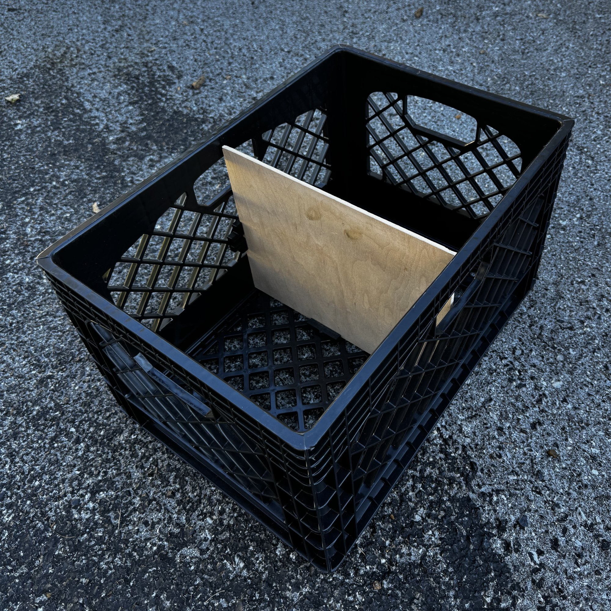

| | |
|---|---|
| 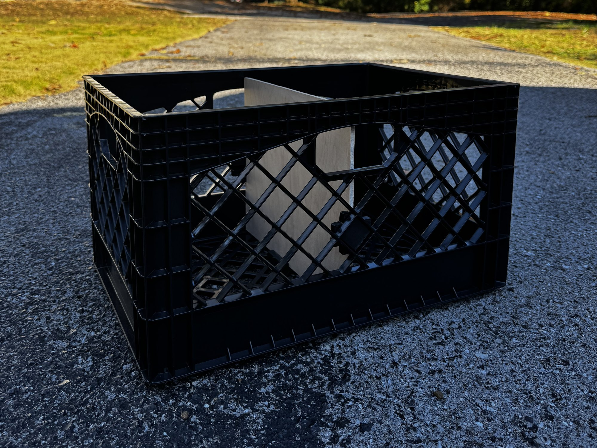 | 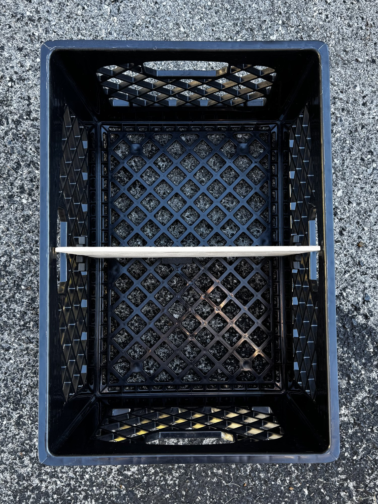 |

## What you need

| | |
|---|---|
| **Crates** | [Juggernaut 24 Quart Storage Crate, 6 pack](https://www.amazon.com/dp/B0D4BWD3GS) (Amazon) |
| **Board** | [1/4" x 4' x 8' Maple Square Sanded Plywood](https://www.lowes.com/pd/SoyStrong-NAF-1-4-in-HPVA-Maple-Plywood-Application-as-4-x-8/1000096494) (Lowe's item #786165, model #712807, about $37). It's an oversized 48-1/2" x 96-1/2" panel and actually 0.203" thick (5.2-5.4 mm). |
| **Per divider** | 1 board, 2 wall clips, 1 floor insert |
| **Printer** | Any FDM printer. PLA or PLA-CF. |

## Boards: 12" wide x 9-7/8" tall, 36 per sheet

Each board spans the crate's width, side wall to side wall, and splits it front to back. At 9-7/8" tall it sits just under the rim, so the crates still stack. The 4x8 sheet gives 4 rips of 12" with 9 boards each.

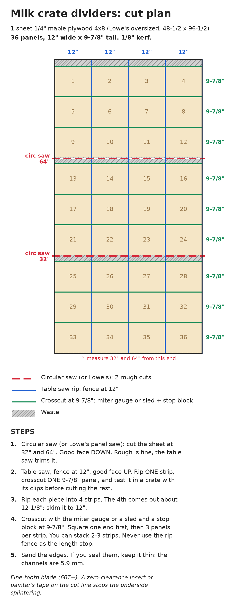

## Printing

The files in [`stl/`](stl) are already oriented: channel face down, plug up. They need no supports.

| Part | File | Each (0.4 nozzle, 0.2 mm, PLA) |
|---|---|---|
| Wall clip | [`stl/wall-clip.stl`](stl/wall-clip.stl) | ~33 min, 12 g |
| Floor insert | [`stl/floor-insert.stl`](stl/floor-insert.stl) | ~30 min, 11 g |

- Print both as-is. Each part's two small "ears" carry the plug square up through the body, so nothing prints over air. The only bridge is the channel ceiling, 5.9 mm across.
- Six walls or 100% infill makes them stiff. Ours are printed in PLA and PLA-CF on an Elegoo Centauri Carbon.

## How it fits

| Wall clip | Floor insert |
|---|---|
| 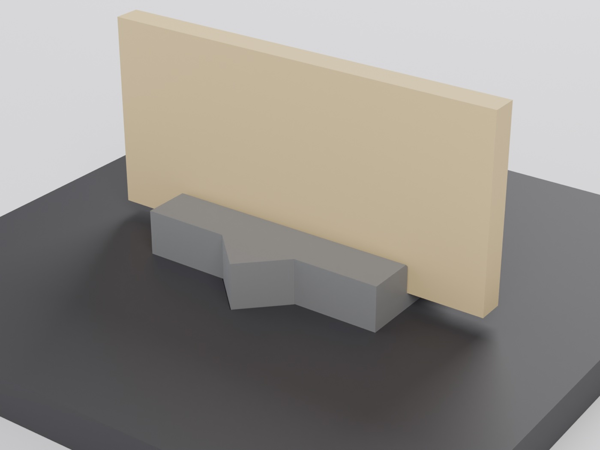 | 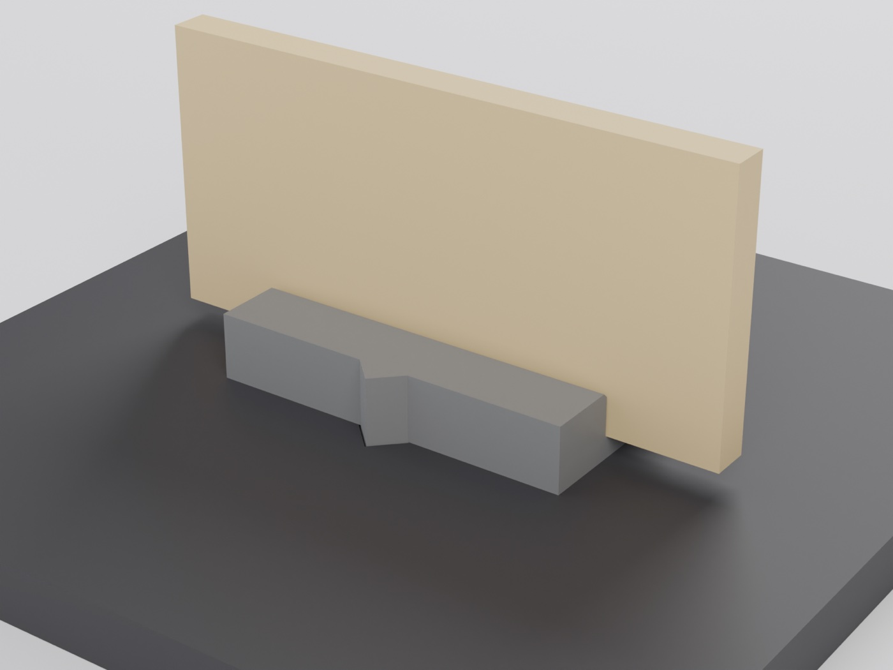 |

| | Wall clip | Floor insert |
|---|---|---|
| Plug (a square turned 45° to match the crate's diamond holes) | 29.65 mm (1.17") across the flats | 23.4 mm (0.92") for the 23.9 mm floor holes |
| Channel | 5.9 mm wide x 6 mm deep | 5.9 mm wide x 6 mm deep |
| Body | 50 x 26 mm, 9 mm thick (42 mm across the ears) | 50 x 26 mm, 9 mm thick (33 mm across the ears) |

| 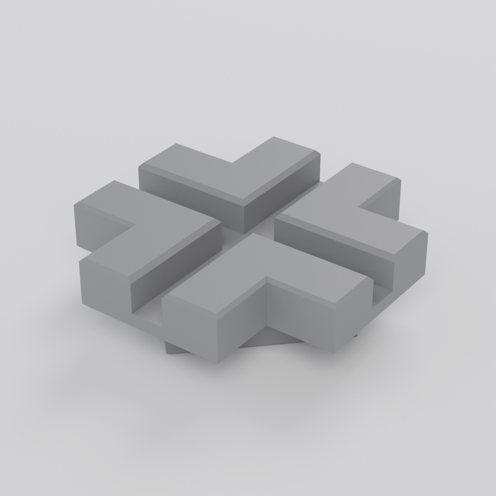 | 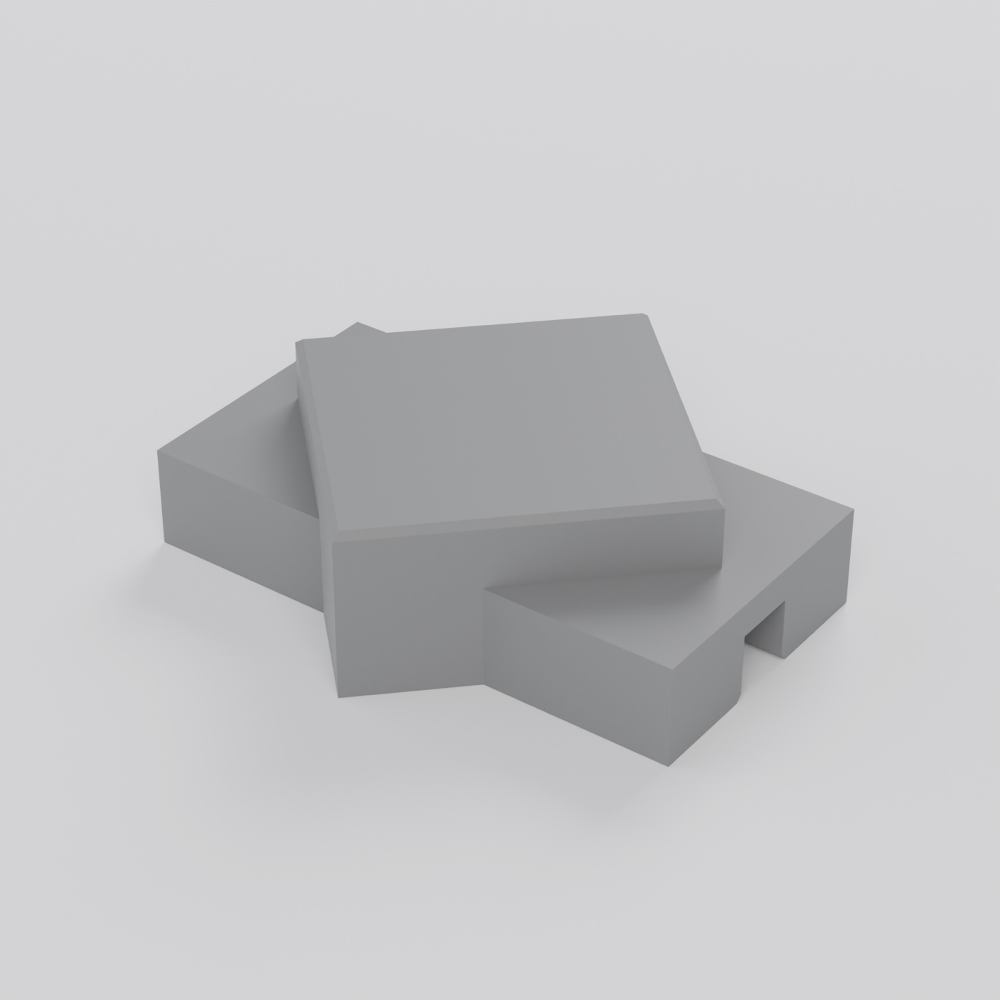 | 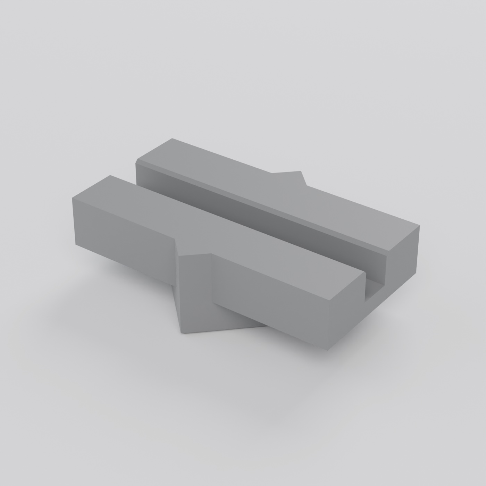 | 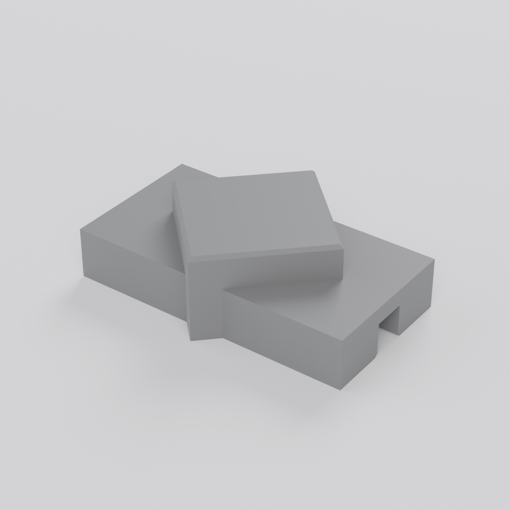 |
|---|---|---|---|
| Wall clip, channel side | Wall clip, plug side | Floor insert, channel side | Floor insert, plug side |

- **Plug fit:** the floor insert's plug is snug by design. If yours won't go in, sand the flats lightly, or drop `PLUG` by 0.1-0.2 mm in the script.
- **Channel:** 5.9 mm leaves about 0.3 mm a side for the 1/4" maple. For 6 mm material (Baltic birch, Sintra, BCX pine), set `SLOT_W = 6.5` in both scripts.
- **Height:** the floor insert lifts the board 3 mm off the crate floor.
- **Shelves:** the plugs are square, so a wall clip turned 90° holds a horizontal board.

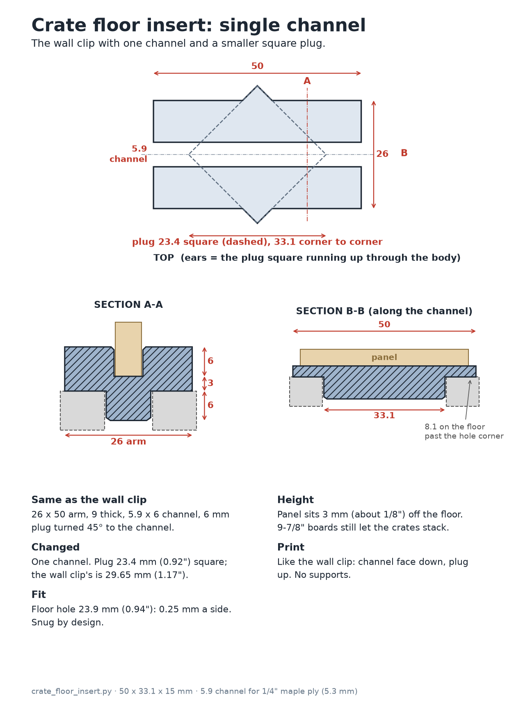

## Changing the parts

[`cad/`](cad) has the parametric source, written in [build123d](https://github.com/gumyr/build123d). Every dimension is a named parameter at the top of each script, with a comment saying why it has that value.

```bash
pip install -r cad/requirements.txt
cd cad
python crate_wall_clip.py      # writes crate-wall-clip.step / .stl / _print.stl
python crate_floor_insert.py   # writes crate-floor-insert.step / .stl / _print.stl
python cut_plan.py ../images/cut-plan.png
```

STEP files for other CAD tools are in [`step/`](step).

## Credits and license

The wall clip is a remix of [Milk Crate Divider by robthewinner](https://www.printables.com/model/34329-milk-crate-divider), licensed CC BY-NC 4.0. This version changes four things:
- It's rebuilt as a parametric script.
- It has one channel instead of the cross, which saves about 15% of the plastic.
- The plug is resized for the Juggernaut crate's holes.
- The channel is narrowed to 5.9 mm for 1/4" plywood.

The single-channel floor insert is new.

Everything here is licensed [CC BY-NC 4.0](LICENSE.md). Share and remix it with attribution, but not commercially.
